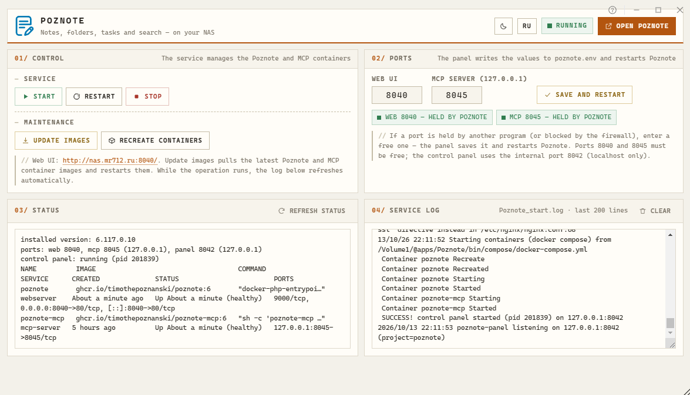
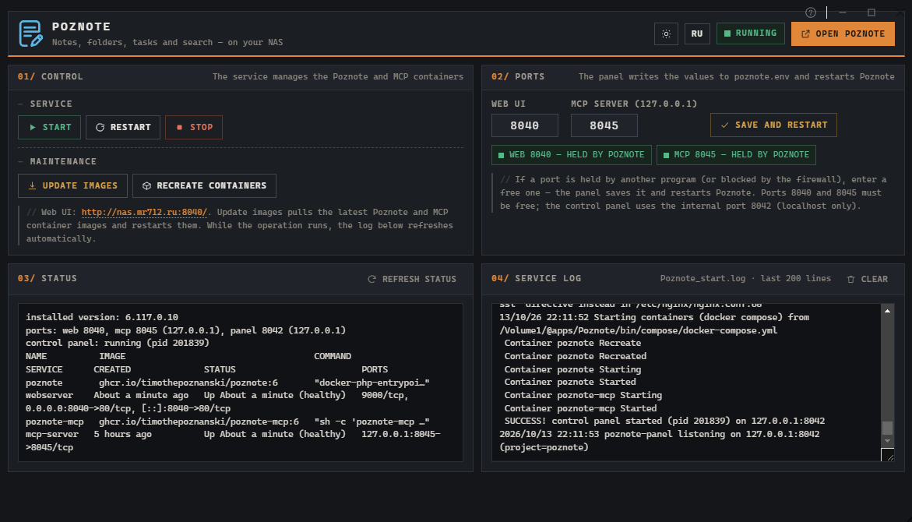

# Poznote Docker Edition — TPK package for TerraMaster (TOS6/TOS7)

> **Language:** English · [Русский](README.md)

<div align="center">

[]()
[]()
[](LICENSE)

  
  <h3>Poznote</h3>
  Powerful note-taking without the hassle.<br/>
  A free, self-hosted, open-source alternative to Notion, Obsidian, Evernote or OneNote.
  <br/><br/>
</div>

| Light theme |
| :---: |
|  |

| Dark theme |
| :---: |
|  |

- Ready-to-use **Poznote 6.117.0.10-beta** package for x86_64 TerraMaster NAS (TOS6/TOS7).
- This is the **Docker Edition**: the application runs in containers built from the official Docker
  images, and the package itself does not bundle them — so the app is updated independently of the package.
- This repository contains releases, the package tree, build tools, and everything needed to rebuild the package.

## Credits

- **Application:** [Poznote](https://github.com/timothepoznanski/poznote) by [Timothé Poznanski](https://poznote.com).
- **TerraMaster TPK packaging:** [Mr712](https://github.com/byMr712?tab=repositories).
- The module structure is inspired by **OutkastM**'s packages (TerraMaster Community Place).
- **The application itself is not bundled** — this is a wrapper around the official Docker images
  [`ghcr.io/timothepoznanski/poznote`](https://github.com/timothepoznanski/poznote) and
  `ghcr.io/timothepoznanski/poznote-mcp`; they are pulled on the NAS at first start.

## Disclaimer

This package is provided **as is**, without warranties of any kind, either express or implied,
including, but not limited to, the implied warranties of merchantability, fitness for a particular
purpose, and non-infringement.

- This package is a **beta** build (6.117.0.10-beta) from a community member and is **not** an
  official release of TerraMaster or Poznote.
- Use at your own risk. The author is **not responsible** for data loss, system crashes, downtime,
  or any other consequences of installing and using this package.
- Always back up your data and NAS configuration before installing or updating.
- There is no guarantee that this package will work on your specific hardware or TOS version.
  Support is provided on a "best effort" basis only.

## License & attribution

- **Poznote** is released under the **MIT License** (Copyright © 2025 Timothé Poznanski).
  Full license text: [`LICENSE`](LICENSE).
- Original TPK module (TOS packaging) © Mr712.
- Change and attribution notices: [`NOTICE`](NOTICE).
- The logo in `images/` comes from the Poznote project (MIT); the module page
  screenshots (`images/PoznoteForTosDockerEdition*_ru.png`) were made by the package author.
- The bundled XZ Utils (`tools/xz/`) are third-party free software — GPL-2.0+ (xz CLI) and
  0BSD (liblzma). See `tools/xz/COPYING*`.

## Requirements

- TerraMaster NAS, **x86_64** architecture, TOS **6.0.420 or higher** (TOS6/TOS7).
- **Docker** installed (the **DockerEngine** app from TerraMaster App Center) with the
  `docker compose` plugin. `config.ini` declares the `DockerEngine` dependency, so the App Center
  warns you itself when Docker is missing.
- Access to **`ghcr.io`** (GitHub Container Registry) on first start — the images come from there.
  If your provider blocks it, point `POZNOTE_IMAGE`/`POZNOTE_MCP_IMAGE` at a registry mirror
  (see "Ports and settings") or pre-load the images on the NAS.
- Free ports **8040** and **8045** (the service panel port `8042` is bound to localhost only).
  If a port is busy, the containers will not start, but the log names the process holding it —
  and you can change the port right on the app page.
- **PHP** — only for the module page (the **Poznote** desktop icon):
  - **TOS6** — PHP is built in, nothing to install;
  - **TOS7** — install **PHP 7.4** (the same requirement as for TerraMaster's own modules).

  The Poznote application and the Go control panel do **not** depend on PHP and work without it.
  Without PHP only the desktop-icon page is unavailable (the app itself is still reachable directly
  at `http://<NAS>:8040/`).

## Install

1. Download `Poznote_TOS7_TOS6_6.117.0.10-beta-x86_64.tpk`.
2. In TOS: **App Center → Settings → Install application manually** (Install from file) and
   pick the `.tpk`.
3. Wait for the installation to finish. A **Poznote** icon appears on the desktop
   (if not, add the app from the application menu).

Images are not bundled inside the package: on first start TOS downloads the current Poznote and
MCP images from GitHub Container Registry.

## Interfaces

| What | Default address | Purpose |
|---|---|---|
| Poznote (application) | `http://<NAS>:8040/` | The note-taking application itself. |
| MCP server | `127.0.0.1:8045` | Localhost only (for AI integrations). |
| Control panel | `127.0.0.1:8042` | Host-side service API/panel. |

## Managing the application

The **app page** (the **Poznote** desktop icon) is a minimal control module: status, log and
buttons. No manual Docker work is needed — every action goes through `/etc/init.d/Poznote <cmd>`.

- **Open Poznote** — jump to the application web UI;
- **Update images** — pulls the latest Poznote and MCP containers and restarts them
  (if `ghcr.io` is unreachable the operation is cancelled with a clear message and the containers
  keep running on the previous images);
- **Restart / Start / Stop**;
- **Recreate containers** — recreates the containers, **your data is kept**;
- **Ports** — change the web and MCP ports: values are written to `poznote.env` and Poznote is
  restarted; next to each field you can see whether the port is free, held by our own containers,
  or taken by a foreign program (named explicitly);
- service status and log view, **Clear log**;
- light and dark theme: a sun/moon button in the header, the choice is remembered in the browser
  (the system preference is used on first open); action buttons are grouped ("Service" and
  "Maintenance") and **Open Poznote** plus the status pill live in the top bar;
- the page is bilingual, **Russian and English**, English by default: the language is switched
  with the **RU/EN** button in the header (next to the theme button) and is remembered in the
  browser — it can also be set by URL, `http://<NAS>/Poznote/?lang=ru`;
- the result of an operation and the progress indicator are shown in a floating bar at the
  bottom of the window: they never move the cards, so the layout does not jump while an
  operation runs (click the message to dismiss it); the status console and the log have a
  fixed height and scroll inside themselves, and **Open Poznote** always uses **http** — the
  application listens on plain HTTP even when the TOS panel is opened over https;
- the look is an "instrument panel" rather than generic white cards with a blue accent:
  monospace type, square corners, hairline rules instead of shadows and gradients, numbered
  sections and buttons that invert on hover. The light theme is a "paper ledger" (warm paper,
  dark amber accent), the dark one is graphite with an amber accent; the console blocks
  (status, log) follow the theme instead of staying black on light;
- the header uses the official Poznote icon (the outlines from the project's
  `sources/images/poznote.svg`, tinted brand blue / light blue), and the same icon is the favicon;
- on a wide window the cards are laid out in two columns (Control | Ports on top,
  Status | Log below); if the module window is short the page is scaled down slightly by height
  (never below ×0.7) so everything stays visible without scrolling.

The log is deliberately kept clean: frequent status polls from the panel (`POZNOTE_QUIET=1`) do not
write routine lines to `/usr/local/Poznote/Poznote_start.log`.

The page is accessible to the TOS superuser account only (the same policy as for TerraMaster's own
modules).

### Desktop icon

TOS normally creates the desktop **Poznote** icon itself when the package is installed. If the icon
is missing (for example after a package update, or on some TOS builds), add it manually:

1. On the TOS desktop open **Start** → **All applications** (in TOS7 — the Start menu / All
   applications entry in the top navigation bar).
2. Find **Poznote** there and either **drag** the icon onto the desktop, or right-click it and
   choose **Add to desktop** (on some builds — **Pin to the navigation bar**).

The icon opens `http://<NAS>/Poznote/` — the path comes from `config.ini` (`path = /Poznote/`,
`type = iframe`, `icon = /images/icons/Poznote.png`). If the icon cannot be created for some
reason, the module page is still reachable directly at `http://<NAS>/Poznote/`, and the
application itself at `http://<NAS>:8040/`.

Everything the page needs is fixed up by the service on every start (`register_web_module` in
`init.d/service`): the `/usr/www/Poznote` → `webui/` symlink, the superuser-only nginx snippet and
the icon file `/usr/www/images/icons/Poznote.png`. No manual NAS file work is required.

## Ports and settings

Settings can be overridden in the `poznote.env` environment file inside the application config
folder:

- **TOS7** — `/usr/local/Poznote/config/poznote.env`;
- **TOS6** — `/usr/local/@APP_CONFIG/Poznote/poznote.env`.

Ask the service for the exact path any time: `/etc/init.d/Poznote configdir`.

```sh
POZNOTE_PORT=8040        # web UI port
POZNOTE_MCP_PORT=8045    # MCP port (localhost only)
POZNOTE_PANEL_PORT=8042  # service panel port (localhost only)
POZNOTE_IMAGE_TAG=6      # image tag (6 = stable channel)
POZNOTE_DATA_DIR=/Volume1/Poznote/data   # data directory
# Full image references — use a registry mirror if ghcr.io is unreachable:
# POZNOTE_IMAGE=docker.m.daocloud.io/ghcr.io/timothepoznanski/poznote
# POZNOTE_MCP_IMAGE=docker.m.daocloud.io/ghcr.io/timothepoznanski/poznote-mcp
```

Changing ports is easier on the app page (the **Ports** card): the panel writes the values to
`poznote.env` and restarts Poznote. It also shows whether a port is free; if it is busy, the service
refuses to start the containers and logs which program holds the port.

By default the data lives in `MAIN_VOLUME/Poznote/data` and survives container recreation. When the
port changes, the **Open Poznote** link follows automatically.

## Behind an external reverse proxy

The application expects direct access by port, a dedicated subdomain, or the domain root, and it
trusts the `X-Forwarded-Proto/Host/Port/SSL` headers.
**A sub-path (e.g. `/poznote/`) is not supported.** Example nginx:

```nginx
location / {
    proxy_pass http://127.0.0.1:8040;
    proxy_set_header Host              $host;
    proxy_set_header X-Forwarded-Proto $scheme;
    proxy_set_header X-Forwarded-Host  $host;
    proxy_set_header X-Forwarded-Port  $server_port;
}
```

## Update

- **Application images:** the **Update images** button on the app page (the same as
  `/etc/init.d/Poznote update`).
- **The package itself:** install the new `.tpk` over the old one via the App Center — the service
  rebuilds the containers and re-registers the module on its own, no NAS reboot required.
- On an in-place upgrade `poznote.env` is **not** overwritten — your ports and other settings are
  preserved.

## Data, backups and removal

- Application data (SQLite database, attachments) lives in the data directory
  (default `MAIN_VOLUME/Poznote/data`) and is **not** deleted when containers are recreated.
- Back up the data directory to a safe place (preferably outside the NAS) before removing the package.
- **Recreate containers** (`reset`) is a safe operation: containers are recreated, data stays.
- Full removal: uninstall the package via the App Center and delete the data directory manually.

## Folder contents

| Path | Description |
|---|---|
| `PoznoteTOS/` | Package tree (payload): `config.ini`, `Poznote.lang`, `INFO`, `version`, `bin/`, `functions/`, `images/`, `init.d/`, `webui.bz2` |
| `webui/` | TOS module sources (the desktop app page), built into `PoznoteTOS/webui.bz2` |
| `tools/build_all.ps1` | Standard one-command build: module + panel + `.tpk` |
| `tools/build_module.ps1` | Builds `webui.bz2` from `webui/` (the `modulemake` tool + `xz`) |
| `tools/build_panel.ps1` | Cross-builds the Go panel into `PoznoteTOS/bin/program/poznote-panel` |
| `tools/build_tpk.ps1` | Builds one `.tpk` from the `PoznoteTOS/` tree |
| `tools/panel/` | Go control panel sources (`main.go`, `index.html`) |
| `tools/modulemake/` | Go utility: GNU tar → `webui.bz2` container format |
| `tools/tarmake/` | Go utility: builds a GNU tar with the correct permissions (`root:root`) for the `.tpk` payload |
| `tools/tarscan/` | Go utility: inspect/verify a built tar (diagnostics) |
| `tools/xz/` | Bundled `xz.exe` + `liblzma-5.dll` + XZ Utils licenses |
| `tools/go.work` | Go workspace so the tools can be built from `tools\` |
| `sources/` | Upstream Poznote sources (git-ignored, not needed to build the `.tpk`) |
| `images/` | Logo and screenshot for the README |
| `README.md` / `README.en.md` | README in Russian (default) and English |
| `LICENSE` / `NOTICE` | License and attribution |
| `.gitignore` / `.gitattributes` | Git configuration |

## .tpk structure

```
[0..2048)      JSON header; "md5" = md5(payload.tar.xz), zero-padded
[2048..10240)  Poznote.lang contents, zero-padded to 8192
[10240..end)   payload.tar.xz (magic FD 37 7A 58 5A 00)
```

Key facts (confirmed by dissecting OutkastM's original packages):
- the `md5` in the JSON header is the md5 of the whole **payload.tar.xz** (not the tar itself);
- the payload is a **GNU** tar (`ustar `), owner/group `root:root`;
- `INFO` lists `1:file:<path>:<md5>` / `1:folder:<path>:`, md5 being the file content hash;
- `config.ini` is present in the payload but is **not** listed in `INFO`.

The `webui.bz2` format (TOS module) is `xz` over a plain GNU tar (no BOM, no UTF-16), owner
`root:root`, directories 0755, files 0644.

## Build requirements

- **PowerShell 7+** (`pwsh`) — building the package on Windows.
- **Go** (verified with 1.27.0) — builds the panel and the tools. Point at it with `-GoRoot`
  (e.g. `-GoRoot E:\go1.27.0`). https://go.dev/dl/
- **Python** — optional (fallback tar builder when Go is unavailable).
- **Windows:** `xz.exe` is bundled in `tools/xz/`, no separate install needed; if missing, the script
  looks for `C:\Program Files\Git\mingw64\bin\xz.exe`.
- Building the `.tpk` **does not require** Docker or a NAS: the containers are pulled from `ghcr.io`
  on the device.

## xz.exe license

XZ Utils is free software. `xz.exe` (the CLI) is licensed under **GNU GPL v2+**, while
`liblzma-5.dll` is under **0BSD** (public domain). The license files therefore live next to the
binaries: `COPYING`, `COPYING.0BSD`, `COPYING.GPLv2` and `AUTHORS`. xz is only needed for building
and is not part of the `.tpk`. Keep these files if you redistribute the `tools/` folder.

## Quick .tpk rebuild from the existing tree

Edit files under `PoznoteTOS/` (e.g. `bin/compose/docker-compose.yml`, `version` — the package
version, `config.ini` and `Poznote.lang` — the App Center name/version), then:

```powershell
pwsh .\tools\build_tpk.ps1
```

The script will:
1. recompute `INFO` (md5 of every file in the tree);
2. build `payload.tar` (tarmake, root:root permissions);
3. compress it with `xz -9e` → `payload.tar.xz`;
4. assemble the `.tpk` (header + .lang + payload) in the parent folder;
5. take the file name and header version from `config.ini`.

The result is named `<id>_TOS7_TOS6_<version>[-<tag>]-<platform>.tpk`, e.g.
`Poznote_TOS7_TOS6_6.117.0.10-beta-x86_64.tpk`.

All default paths are **relative to the script folder** `tools\`: package tree `..\PoznoteTOS`,
output `..`. Intermediates go to the `tools\_build\` scratch folder and are removed afterwards.
The script can be run from anywhere.

Options: `-PkgDir <path>` (default `..\PoznoteTOS`), `-OutDir <where to put the .tpk>` (default `..`),
`-XzPath <path to xz.exe>`, `-ReleaseTag <version suffix in the file name>` (default `beta`; use
`-ReleaseTag ''` for a stable release).

## Rebuilding the panel and the module

Standard build of everything at once:

```powershell
cd E:\GitHub\PozNoteForTosDockerEdition
pwsh -NoProfile -File .\tools\build_all.ps1 -GoRoot E:\go1.27.0
```

Individual stages:

```powershell
pwsh .\tools\build_module.ps1 -GoRoot E:\go1.27.0   # webui/ -> PoznoteTOS/webui.bz2
pwsh .\tools\build_panel.ps1  -GoRoot E:\go1.27.0   # tools/panel -> PoznoteTOS/bin/program/poznote-panel
pwsh .\tools\build_tpk.ps1                          # PoznoteTOS/ -> Poznote_..._x86_64.tpk
```

`build_all.ps1` flags: `-GoRoot <Go dir>`, `-SkipModule`, `-SkipPanel` (when the module/panel sources
have not changed) and `-ReleaseTag <suffix>`.

**The page module** (`webui/index.php`) is self-contained PHP compatible with **PHP 7.4+** (no PHP 8
constructs). The page needs PHP on the NAS: TOS6 has it built in, TOS7 needs PHP 7.4 installed (the
same dependency as OutkastM's modules). The application and the Go panel do not depend on PHP.

**The control panel** (`tools/panel`) is a Go binary; the service starts it as root on the NAS host,
listening on `127.0.0.1:8042` (`-listen` flag) and talking HTTP.

## Application configuration

- `bin/compose/docker-compose.yml` — the `poznote` (web) and `poznote-mcp` containers.
  Images: `ghcr.io/timothepoznanski/poznote` and `.../poznote-mcp`, tag `POZNOTE_IMAGE_TAG`
  (default `6` — the stable channel). Data volume: `${POZNOTE_DATA}:/var/www/html/data`.
- `init.d/service` — the TOS service:
  `start|stop|reload|update|status|reset|clearlog|configdir|ports|inst_version|dep_check`.
  On start it checks Docker, port availability and registry reachability; on a port conflict or an
  unreachable `ghcr.io` the containers are **not** started, but the control panel still comes up and
  the reason is written to `/usr/local/Poznote/Poznote_start.log`.
- `bin/Poznote.nginx.conf` — the `AppAccessControl` snippet (`auth_request` → `127.0.0.1:5057/validate`),
  superuser-only access to the page.
- `functions/dependapps.sh` — TOS dependency helpers (from OutkastM's reference packages).
- `bin/program/poznote-panel` — the Go control panel (built by `build_panel.ps1`).
- `version` — the package version (`<upstream app version>.0`); change it in sync with `config.ini`
  and `Poznote.lang`.
- `webui.bz2` — the TOS page module (built by `build_module.ps1`).

## File permissions in the payload (as in the original)

| File | Mode |
|---|---|
| `INFO`, `init.d/service` | 0755 |
| `bin/program/*`, `functions/*.sh` | 0744 |
| directories | 0755 |
| everything else | 0644 |

All files are owned by `root:root`.

## Verifying the result

```powershell
# 1. the header md5 must match the payload md5 (offset 10240)
$b = [IO.File]::ReadAllBytes("$pwd\Poznote_TOS7_TOS6_6.117.0.10-beta-x86_64.tpk")
# 2. the payload extracts and its permissions/contents match the package tree
#    (slice the bytes from offset 10240 and inspect with tar -tvf)
```

On the NAS:

```sh
/etc/init.d/Poznote status       # state, ports, containers
/etc/init.d/Poznote ports        # who holds the ports (free / ours / foreign <who>)
/etc/init.d/Poznote configdir    # where poznote.env lives
```

## Links

- Poznote application: <https://github.com/timothepoznanski/poznote> · <https://poznote.com>
- Demo: <https://demo.poznote.com> (login/password `poznote`)
- Application docs: `sources/docs/` (including `README.md`, English)
